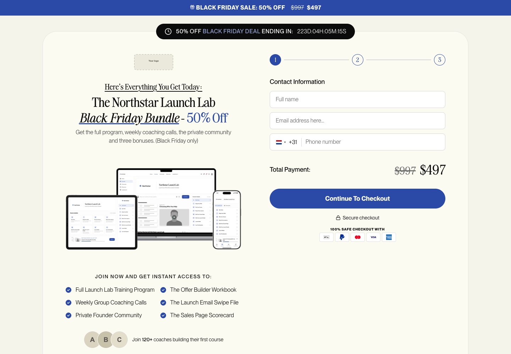

# Mid-ticket Checkout Funnel

A free, ready-to-sell template for a mid-ticket offer: a long-form sales page with a **two-step checkout built into the page**, plus a **welcome page** for buyers.

**Access:** this repository is invite only. Sign in to GitHub with the account that received the invite to clone it, download the ZIP or import it. To preview it, serve the folder locally (see [SETUP.md](SETUP.md)).

## What it does

- **Two-step checkout on the page.** Step 1 takes name, email and phone (with a country picker). Step 2 shows your checkout right below it, and the page never jumps. With an embedded checkout (Whop, ThriveCart, SamCart and others), visitors never leave the page. With a checkout link (Stripe Payment Links and others), they go to the provider's page with their email filled in.
- **Leads go anywhere.** Every step-1 lead is posted to any webhook you list: Zapier, Make, n8n, a Google Sheet or your own server. GoHighLevel and other CRMs connect through one of those. It happens before payment, so you can follow up on abandoned checkouts.
- **Bring your own checkout.**
  - **Whop:** paste your plan ID.
  - **Any embed code:** ThriveCart, SamCart and others.
  - **Any checkout link:** Stripe Payment Links, GoHighLevel payment links and others.

  The buyer's email is filled in for you where the provider allows it.
- **One honest countdown.** The same deadline for every visitor. When it passes, the checkout closes (or keeps selling, your choice).
- **A welcome page that converts the moment after purchase:** confetti, a "You did it, Sam!" greeting and three clear next steps. Failed or cancelled payments are sent back to the checkout with a message.
- **Theme in one file.** Every colour and font lives in `css/theme.css`.
- **Plain files.** HTML, CSS and a little JavaScript. No build step, no framework, and no third-party requests unless you add them. Fonts are self-hosted.
- **Placeholder guard.** Example content is marked, and a red badge counts what you still need to replace, so you never go live with sample testimonials.

## Make it yours with one prompt

Open **[PROMPT.md](PROMPT.md)**, copy the prompt (the copy button sits at the top right of the box) and paste it into an AI coding tool:
- Claude Code, Cursor, Codex or Windsurf;
- **Bolt:** use "Import from GitHub" with the GitHub account that received the invite, then paste the prompt;
- **Replit:** Create > Import from GitHub (signed in with the invited account) > paste the repository URL, then paste the prompt.

Lovable is not supported yet, because it cannot import an existing repository.

The AI works in stages:
1. It reads the template.
2. It interviews you a few questions at a time: hosting, brand, offer, what buyers get, proof, checkout, leads and tracking.
3. It matches the graphics to what you sell.
4. It shows you a build summary and waits for your yes.
5. It builds, tests and deploys when you say so.

It never invents testimonials, results, guarantees or urgency: anything you don't have is left out.

## Without AI

1. Download the ZIP (Code > Download ZIP) and unzip it.
2. Follow [SETUP.md](SETUP.md): edit `funnel.config.js`, `css/theme.css` and the text in `index.html` and `welcome.html`.
3. Drag the folder onto [Netlify Drop](https://app.netlify.com/drop). Other hosts are covered in [docs/DEPLOY.md](docs/DEPLOY.md).

## Webflow

A cloneable Webflow version is on its way. This page will link to it.

## What's in the box

| File | What it is |
|---|---|
| `index.html` | the sales page with the two-step checkout |
| `welcome.html` | the page buyers land on after paying |
| `funnel.config.js` | all settings: price, deadline, lead webhooks, checkout |
| `css/theme.css` | all colours and fonts |
| `PROMPT.md` | the build prompt for your AI tool |
| `SETUP.md` | the full manual (for you or your AI) |
| `assets/graphics/` | sample graphics for each kind of deliverable (course, coaching, 1:1, community, support, bonuses) |
| `docs/` | lead destinations, checkout providers, deploying and tracking |
| `tests/` | the maintainer's automated tests (you don't need them) |

## Disclaimer

This template is free and provided as is, without any warranty. The Conversion Brands and its founder are not responsible for how you use it, for the pages you publish with it, or for any results, losses or claims that come from them.

When you use it, you are responsible for:
- your offer, copy, claims, prices, testimonials and results;
- your legal texts: privacy policy, terms, refund policy, cookie consent, and the earnings and platform disclaimers your ads or platforms require (Meta/Facebook, for example);
- following the laws and rules that apply to you: consumer, advertising and data-protection law, and your payment provider's and ad platforms' policies;
- your checkout, lead and tracking setup.

The sample content and graphics are examples only, and nothing in this repository is legal, financial or tax advice. Get professional advice where you need it.

## Credits and licence

Template by **The Conversion Brands**. Want it built and launched for you? [theconversionbrands.com](https://theconversionbrands.com/)

Free to use for your own and your clients' funnels under the [MIT licence](LICENSE). Bundled pieces keep their licences:
- the fonts: SIL Open Font License, in `assets/fonts/`;
- the icons: Lucide, ISC;
- the payment glyphs: Simple Icons, CC0;
- intl-tel-input: MIT;
- canvas-confetti: ISC.
